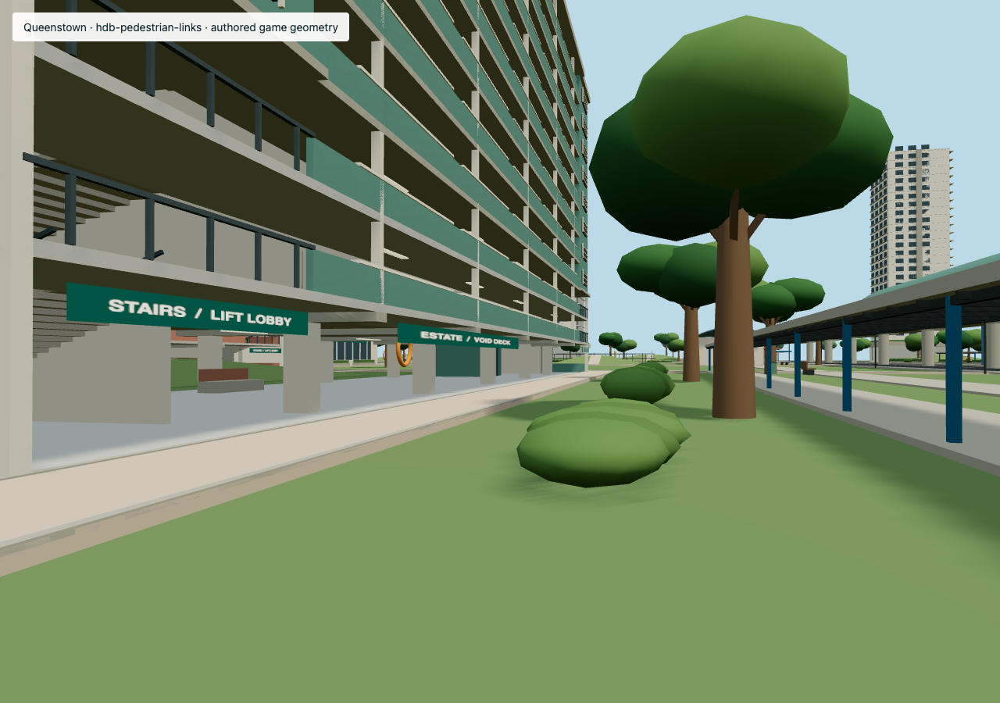

# Queenstown: residential landscape and cover

Queenstown now has connected pavement links between the outer sidewalks,
station approaches, housing decks, gardens and community court. Paths continue
over nine walkable earth banks, 1.6–3.2 m high. Broad slopes have no fenced
edges or stairs; the rendered earth and infantry/bot support share the same
planes and convex outlines. The banks interrupt low horizontal fire across
previously flat lawns. Streets retain their driving clearance.

The pass adds 35 pavement links, 45 shade trees, 58 broken shrub beds and nine
earth banks. Supplemental trees sit at junctions, lawn edges and selected banks.
Broken shrub beds are approximately 0.85–1.5 m tall, with frequent lateral
openings. Short masonry seats provide actual crouching cover. Tree crowns and
shrubs conceal a silhouette; trunks, masonry and earth stop rounds. Designated
foliage participates in bot/drill sight and player-pilot visual perception,
while bullets and blast cover queries pass through it. High crowns remain
above pedestrian sightlines.

This is an authored gameplay landscape in the existing compressed district,
not surveyed Queenstown terrain. No new reference captures or acceptance
claims were made. HDB decks, stairs, stamps and district extent remain usable.

## Measurements

Run `pnpm analyse:cover -- --district queenstown --sectors` or add `--json`.
The report now includes **mean**, median and p90 distances to **solid** and
**visual** cover for standing, crouching and prone players. Visual cover
includes solid cover, so it cannot be farther away on the same sample.

The baseline and final layout below use the same new method and foliage
classification, with FPS collectibles hidden. The baseline scene comes from
`e16021b7605c6d5935d106d9204a8a9a73f4861b`. Full district/sector data is in
[the comparison report](evidence/queenstown-cover-comparison.json).

| Posture | Mean solid before → after | Mean visual before → after | Solid p90 before → after |
| --- | --- | --- | --- |
| Standing | 15.5 → 13.3 m | 15.5 → 13.2 m | 30.0 → 24.1 m |
| Crouching | 14.8 → 12.1 m | 14.6 → 11.7 m | 28.4 → 22.4 m |
| Prone | 14.5 → 11.6 m | 14.1 → 10.7 m | 28.3 → 22.0 m |

The earlier report returned about 36 m median and 93 m p90 for crouch cover.
Those numbers use the legacy method and must not be compared directly with
this table. That method loses thin walls between sample centres, excludes
useful trunks and ignores terrain height. Its `crouch`/`stand` JSON fields and
sector-label contract are retained for compatibility. The new `proximity`
fields are the terrain-aware diagnostic.

The new diagnostic samples occupiable outdoor ground on a 2 m lattice,
including zero-distance samples inside traversable concealment. Source boxes
touching a cell are retained, so a thin wall does not vanish between lattice
centres. Mesh bounds approximate silhouettes; actual earth top planes replace
whole-hill bounding boxes. Eye height follows local terrain in 25 cm bands.
Building galleries are excluded from this outdoor-ground population. Sector
summaries reuse the district field, including cover across sector boundaries.
No sources produce Infinity (`null` in JSON); no occupiable samples produce a
null summary. The `within2m` field is a fraction of the sampled population.

This is horizontal proximity, not a shortest walking route or a guarantee
against a particular shooter. Cover direction, body width, elevated attackers,
penetration rules and the paths around obstacles need separate checks. Open
roads/courts and exposed perimeter samples remain; the worst sampled distance
is 58 m. The district average alone is not a map-health verdict.

## Repeatable verification

- `queenstown-landscape.test.ts` walks every slope up/down at both body radii
  and probes earth against prone, crouched and standing rays where tall enough.
  It bounds the district mean and p90 and checks concealment against solid cover.
- `scene-cover-metrics.test.ts` covers thin walls, adjacent sectors, foliage,
  overhead crowns, empty samples and local terrain height.
- `fps-raycast.test.ts` checks instanced foliage at all three eye heights and
  a host-owned damaging shot passing through it.
- Existing Queenstown housing, road, stamp and sector checks still apply.
- With Vite HMR disabled and Chrome CDP running, run
  `FPS_APP_ORIGIN=http://127.0.0.1:5174 FPS_CHROME_ORIGIN=http://127.0.0.1:9223 node scripts/queenstown-landscape-smoke.mjs`.
  This uses ordinary WASD in FPS and RegionGame to ascend, cross and descend a
  bank in both directions, and checks the host actor's crest elevation.
- `REGION_APP_ORIGIN=http://127.0.0.1:5174 node scripts/review-queenstown-landscape.mjs`
  saves nine overview/eye-height views under `.cache/queenstown-landscape-review`.
  The reviewed run had no runtime exceptions or Google requests.

## Pointers for the next residential district

Connect daily destinations with pavement first. Keep planting alongside those
routes, leave lateral openings and distribute shade without filling every lawn
with trees. Separate low concealment from masonry/earth protection in both
metrics and combat. Use broad, walkable changes of ground level to interrupt
selected long sightlines. Check every sector and its p90, then walk the routes
and test low/high rays through the actual rendered geometry.
